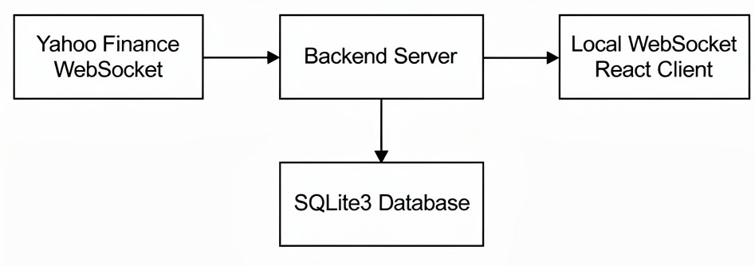

# Live Stock Price Fetching from Yahoo Finance

This project involves fetching live stock prices from Yahoo Finance using their websocket: streamer.finance.yahoo.com. 
The backend connects to the Yahoo Finance websocket, retrieves data as it is sent, and stores the data in a database using SQLite3. The websocket from Yahoo sends its data in a protobuff format, the necessary information for decoding is included and implemented.

A local websocket server is also set up to connect to a React client, where a line graph is updated in real-time as new stock prices are received. By using a local websocket, we avoid the need to access the database for plotting, allowing for real-time updates.

Here is an overview of the connections:



This project can serve as a starting point for developing multiple different ideas. 
Since the database stores all the data, we could implement time series algorithms for stock price prediction in the backend (not [HFT](https://en.wikipedia.org/wiki/High-frequency_trading)). Additionally, the client could be further developed to create a more extensive dashboard.
    
**Note:** This guide is specifically for Linux/Unix systems.

## Table of Contents

- [Prerequisites](#prerequisites)
- [Usage](#installation)


## Prerequisites

**Node.js** and **npm** is required.

## Usage

The server and client are built seperately, which allows them to be reused for different purposes.

### Server
To run the server, grant execute permissions to server.sh and run:

```sh
chmod +x server.sh
./server.sh
```

This will install the necessary npm packages and execute the script. An empty SQL database will be created where stock prices will be stored.

### Client

To run the client grant execute permission to client.sh and execute
```sh
chmod +x client.sh
./client.sh

```
This will install necessary npm dependancies for the client, and the graph can be inspected at localhost:3000
BTC-USD is the ticker preconfigured, since it is not dependant on market hours. But each update from the websocket takes approximately 1 minute each, so be patient for the graph to be updated.

