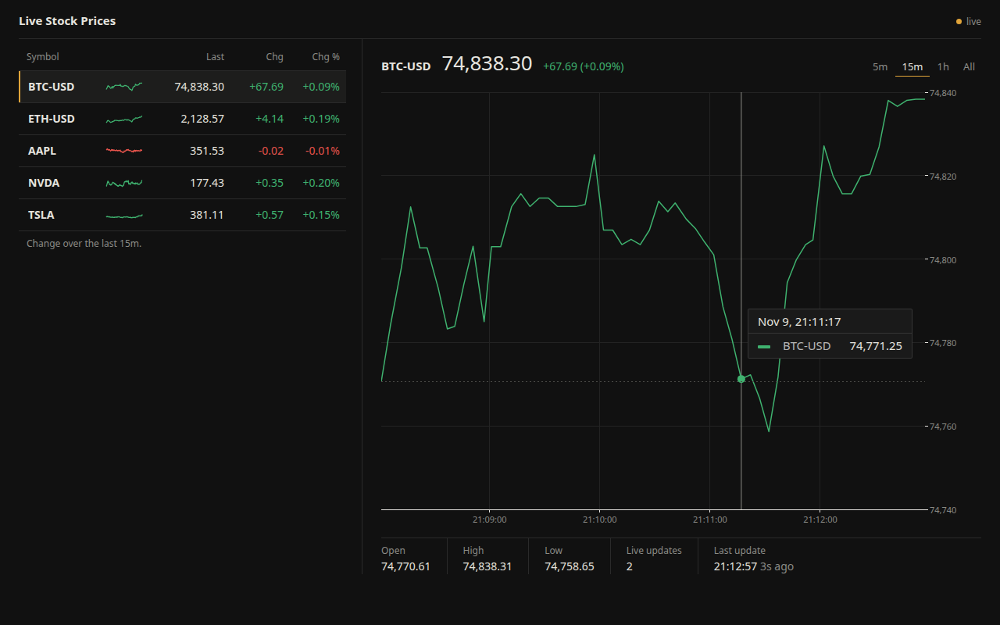
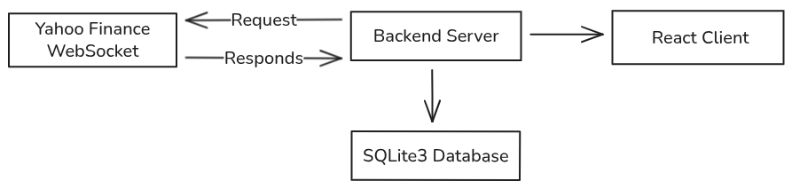

# Live Stock Prices

This project shows live stock and crypto prices from Yahoo Finance on a page that updates in real time.

The server connects to the Yahoo Finance WebSocket (`wss://streamer.finance.yahoo.com`). Yahoo sends each price as a base64 encoded protobuf message. The server decodes it with the schema in `server/src/tickerproto.proto`, saves the price in a SQLite database, and forwards it to every browser connected to a local WebSocket.

The client is a React app (Vite + TypeScript + MUI X Charts). When it connects, it asks the server for the most recent prices of every ticker, draws them, and then adds each new price as it arrives. Live prices go straight from the server to the browser, so plotting does not need to read the database.



An overview of the connections is shown further down.

## Features

- A watchlist with a row for every ticker the server follows: symbol, small sparkline, last price, change and change in percent (green or red). Click a row to show that ticker in the large chart.
- A large line chart with time on the x axis, prices on the right, a dotted line at the first price in the range and a tooltip that shows the exact time and price.
- Time range buttons (5m, 15m, 1h, All). The change, high and low are measured over the chosen range.
- A stats row with open, high, low, number of live updates and the time of the last update.
- The last price gets a short green or red tint when a new price arrives.
- A small status text in the header (live, connecting or offline) with a colored dot.
- The browser tab title shows the selected ticker and its last price.
- The layout works on narrow screens: the watchlist moves above the chart.



This project can serve as a starting point for other ideas. Since the database stores all the data, the backend could run time series models for price prediction (not [HFT](https://en.wikipedia.org/wiki/High-frequency_trading)). The client could also grow into a fuller dashboard.

## Table of Contents

- [Features](#features)
- [Prerequisites](#prerequisites)
- [Usage](#usage)
- [Configuration](#configuration)
- [Message protocol](#message-protocol)
- [Project layout](#project-layout)
- [Tests](#tests)
- [Future Improvements](#future-improvements)

## Prerequisites

**Node.js 20.19 or newer** and **npm**.

## Usage

The server and the client are separate npm projects. Start the server first, then the client, each in its own terminal.

### Server

```sh
cd server
npm install
npm start
```

This creates the SQLite database (`tickerdata.db`) if it does not exist, connects to Yahoo, and starts a WebSocket server on port 8080 (`ws://localhost:8080` from the same machine).

### Client

```sh
cd client
npm install
npm run dev
```

Open http://localhost:3000 to see the dashboard.

To build a production version of the client, run `npm run build`. The files are written to `client/dist`.

BTC-USD is the default ticker because crypto trades all day, every day, so prices arrive outside market hours too. Yahoo sends a new BTC-USD price every few seconds, but it can be slower, so give the chart a moment to fill.

## Configuration

The server reads these environment variables:

| Variable   | Default                             | Meaning                                       |
| ---------- | ----------------------------------- | --------------------------------------------- |
| `TICKERS`  | `BTC-USD`                           | Comma separated list of tickers to subscribe to |
| `PORT`     | `8080`                              | Port of the local WebSocket server            |
| `DB_PATH`  | `tickerdata.db`                     | Path of the SQLite database file              |
| `YAHOO_URL`| `wss://streamer.finance.yahoo.com/` | Yahoo WebSocket address                       |

The client reads `VITE_SERVER_URL` (default `ws://localhost:8080`).

Example with two tickers on another port:

```sh
cd server
TICKERS=BTC-USD,ETH-USD PORT=8090 npm start
```

```sh
cd client
VITE_SERVER_URL=ws://localhost:8090 npm run dev
```

All tickers are saved in the database and shown as rows in the watchlist. The first ticker is selected when the page opens.

Both sides reconnect on their own if a connection drops. They wait 1 second, then 2, 4 and so on, up to 30 seconds. The server also pings Yahoo and the browsers every 30 seconds and drops connections that stop answering.

## Message protocol

The browser and the server talk with small JSON messages. The types live in `shared/protocol.ts` and are used by both sides. The browser can only ask for history. Any other message is rejected.

| Direction        | Message                                                      |
| ---------------- | ------------------------------------------------------------ |
| server to client | `{ "type": "tickers", "tickers": ["BTC-USD"] }` (sent on connect) |
| client to server | `{ "type": "history", "ticker": "BTC-USD", "limit": 100 }` (limit is kept between 1 and 500) |
| server to client | `{ "type": "history", "ticker": "BTC-USD", "prices": [...] }` (oldest first) |
| server to client | `{ "type": "price", "ticker": "BTC-USD", "price": 74500.12, "time": 1762700000000 }` |
| server to client | `{ "type": "error", "message": "..." }`                      |

`time` is always a UTC timestamp in milliseconds since 1970, so the browser shows it in the local time zone correctly.

## Project layout

```
server/src/index.ts           starts everything and runs the local WebSocket server
server/src/yahoo.ts           Yahoo connection, protobuf decoding and reconnects
server/src/db.ts              SQLite table, inserts and history queries
server/src/config.ts          environment variables
server/src/tickerproto.proto  protobuf schema for Yahoo messages
shared/protocol.ts            message types shared by server and client
client/src/useLivePrices.ts   React hook that connects to the server and keeps prices per ticker
client/src/App.tsx            dashboard layout, time range and stats row
client/src/TickerRow.tsx      watchlist row with sparkline
client/src/PriceChart.tsx     large line chart (MUI X Charts)
client/src/market.ts          time ranges, summary numbers and number formatting
```

## Tests

```sh
cd server
npm test           # protobuf decoding, message checks, database queries
npm run typecheck  # TypeScript in strict mode
```

```sh
cd client
npm run typecheck
npm run build
```

## Future Improvements

- Let the user add or remove tickers in the browser.
- Add other chart types, such as candlesticks.
- Add an algorithm that sends a buy or sell notification.
